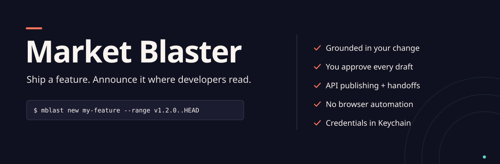
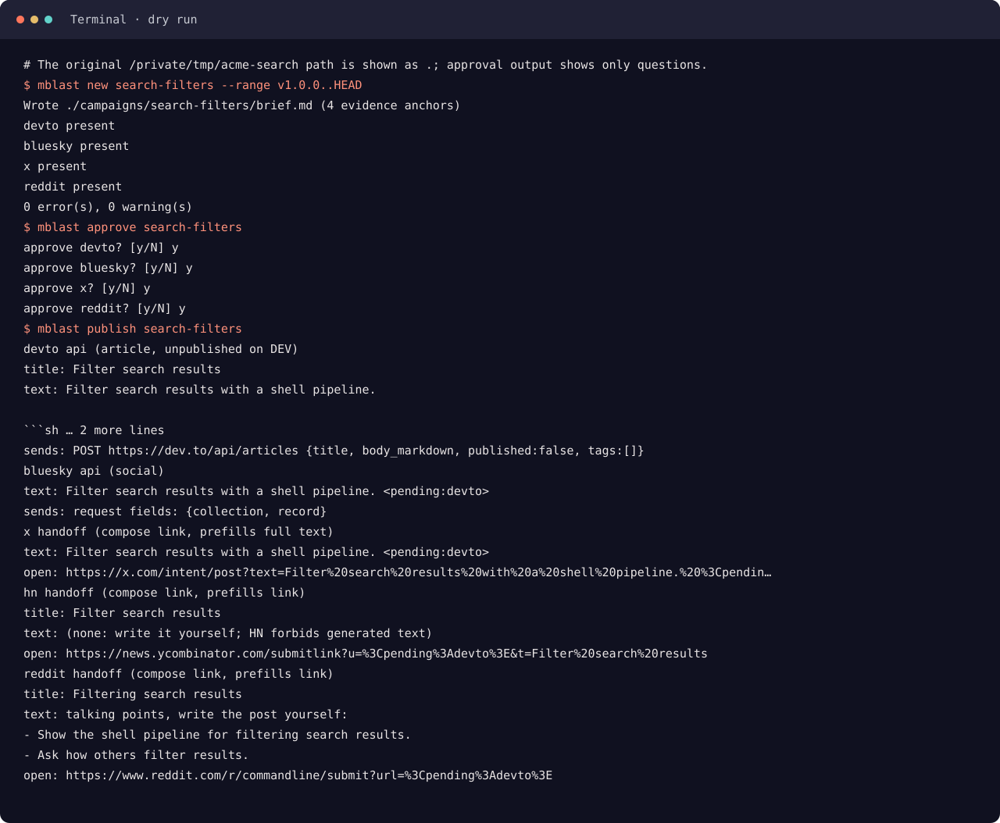

<p align="center">
  
</p>

<p align="center">
  <a href="https://github.com/edwinjosechittilappilly/market-blaster/actions/workflows/ci.yml"></a>
  <a href="https://edwinjosechittilappilly.github.io/market-blaster/"></a>
  <a href="LICENSE"></a>
  
  
</p>

# Market Blaster

Market Blaster turns a shipped change into platform-specific posts. It gathers evidence from a git range, PR and
CHANGELOG, asks an agent to draft from that brief, and checks the results. You edit and approve each draft in your
terminal before publishing through APIs or completing a manual handoff.

## Quickstart

Requires Node 22.18+, git, access to this private repository, and a configured drafting agent. Install from a clone:

```bash
gh repo clone edwinjosechittilappilly/market-blaster
cd market-blaster
npm install
npm link
mblast install-skill
```

In the repository you want to announce:

```bash
mblast init
# Edit market-blaster.yml: brand, destinations and agent.command
mblast auth set DEV_API_KEY                      # macOS Keychain; use .env or shell elsewhere
mblast new my-feature --range v1.2.0..HEAD       # add --pr 42 when available
$EDITOR campaigns/my-feature/drafts/*.md
mblast check my-feature
mblast approve my-feature                        # interactive approval of each draft
mblast publish my-feature                        # dry run
mblast publish my-feature --yes                  # publish approved API destinations
mblast publish my-feature --assist               # complete handoffs and record permalinks
mblast status my-feature
```

`--assist` opens official pages for you to submit; it does not click Post. The example below uses a fake drafting agent
and dummy DEV and Bluesky credentials. The final command is a dry run, so it sends nothing.

<p align="center"></p>

## What goes where

| Destination | Publishing mode and draft policy |
|---|---|
| DEV, GitHub Gist, GitHub Discussions | API; editable drafts |
| Bluesky, Mastodon, Nostr | API; editable drafts |
| LinkedIn | Share handoff, or opt-in API; editable draft |
| X | Intent handoff, or opt-in paid API; editable draft |
| Hashnode | API when configured; Hashnode Pro required |
| Hacker News | Manual link and title only; no generated text |
| Reddit, Product Hunt, Lemmy, newsletters | Manual submission; AI talking points only |
| Threads, Medium, Substack | Manual compose, import or editor handoff; editable draft |

`mblast launch` tracks one-time directory submissions separately from campaigns.

## How it compares

Market Blaster is its own code. Its only publishing dependency is [Crosspost](https://github.com/humanwhocodes/crosspost)
(Apache-2.0), which handles X and LinkedIn signing. The tools below are alternatives we researched before building:

| | Market Blaster | [Pipepost](https://github.com/MendleM/Pipepost) | [Typefully](https://typefully.com/) | [Buffer](https://buffer.com/) | [Postiz](https://postiz.com/) | [Crosspost](https://github.com/humanwhocodes/crosspost) |
|---|:-:|:-:|:-:|:-:|:-:|:-:|
| Starts from a code change (commits, diff, PR, changelog) | ✅ | — | — | — | — | — |
| AI drafts per platform | ✅ grounded in evidence | ✅ from an article | — | — | — | — |
| Flags claims that aren't in the evidence | ✅ | — | — | — | — | — |
| Developer article platforms (DEV, Hashnode, Gist, GitHub) | ✅ | ◐ DEV, Hashnode | — | — | — | ◐ DEV |
| Social (Bluesky, Mastodon, LinkedIn, X) | ✅ API or compose link | ✅ | ✅ | ✅ | ✅ | ✅ |
| HN, Reddit, Product Hunt guidance | ✅ compose links, no AI text for HN | ◐ variants | — | — | ◐ Reddit | — |
| Approval locked to the exact text | ✅ terminal, hash-checked | — | ◐ drafts in app | ◐ drafts in app | ◐ drafts in app | — |
| No duplicate posts on rerun | ✅ | — | — | — | — | — |
| Scheduling and analytics | — | — | ✅ | ✅ | ✅ | — |
| Interface | CLI + agent skill | MCP | Web, API, MCP | Web, API | Web, API, CLI, MCP | CLI, library, MCP |
| Cost | Free, Apache-2.0 | MIT, credits for some features | Free and paid tiers | Free for 3 channels, then $6/channel/mo | Free self-hosted (AGPL) or paid | Free, Apache-2.0 |

✅ supported · ◐ partial · — not offered or not documented in [our research](docs/research/existing-skills-and-tools.md)
(snapshot 2026-11-21). Use a scheduler alongside Market Blaster if you need queues and analytics.

## Safety

- Approval records a hash of the exact draft; a changed draft needs approval again before publishing.
- The agent receives a temporary workspace and a filtered environment, not publishing credentials or the project
  files. This is **not a security sandbox**: the agent runs as your user. Use your agent's sandbox where available.
- API errors with an uncertain outcome block reposting until you resolve them with `mblast mark`. A lock prevents
  overlapping publish runs.
- There is no browser automation. HN gets a title and link; outline-only destinations require you to write the post.
- macOS credentials can be stored in Keychain. Shell variables and a project `.env` are also supported.

## Documentation

Read the [getting started guide](https://edwinjosechittilappilly.github.io/market-blaster/getting-started/),
[commands](https://edwinjosechittilappilly.github.io/market-blaster/commands/),
[configuration](https://edwinjosechittilappilly.github.io/market-blaster/configuration/),
[destinations](https://edwinjosechittilappilly.github.io/market-blaster/destinations/) and
[credentials](https://edwinjosechittilappilly.github.io/market-blaster/credentials/). The
[full guide](docs/guide.md) is also available in this repository.

## Development

Contributions are welcome. Install dependencies, then run:

```bash
npm test
npm run typecheck
make docs-serve
```

## License

[Apache-2.0](LICENSE).
