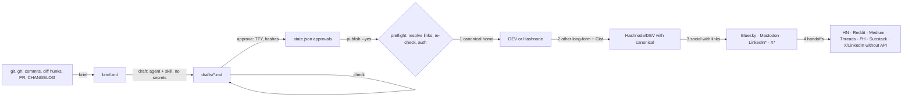

# Market Blaster design

Status: accepted after review 1 · Bead: market-blaster-88g.4 · Research:
[existing skills and tools](../research/existing-skills-and-tools.md), [platform APIs](../research/platform-apis.md) ·
Review: [2026-11-22 design review](../reviews/2026-11-22-design-review.md) (all 4 blockers fixed below)

## Context

I ship features across several repos and want one place to announce them on the platforms developers read: DEV,
Hashnode, GitHub Gist, LinkedIn, X, Bluesky, Mastodon, Hacker News and Reddit. Each platform needs different copy, and
generic marketing text reads as spam to developers.

The research found two gaps. First, existing tools start from a finished article (Pipepost) or from channel variants an
agent already wrote (content-distribution-mcp). None starts from the shipped change itself (commits, diff, PR,
changelog) and keeps each claim traceable to it. Second, platform access is uneven:

- **API, free:** DEV, Gist, Bluesky, Mastodon.
- **API, gated:** Hashnode needs a Pro publication. X charges $0.015 per post, or $0.20 when the post has a URL. LinkedIn
  needs a "Share on LinkedIn" app, and its tokens last about 60 days. The research places X and LinkedIn in the
  *assisted* set for v1.
- **No usable write API:** HN has none. Medium issues no new tokens. Reddit needs approval and is subreddit-restricted.
  Threads, Product Hunt and Substack are gated or closed.

## Goals

1. From a git range to checked drafts with one command (`mblast new`).
2. One command publishes to every API destination; every other destination gets its final copy and a compose link.
3. A human approves exact content before anything is published, and no unchanged content is ever posted twice,
   including after timeouts and crashes.
4. Claims in drafts are traceable to the brief, and `check` flags ones that are not.
5. Reusable: one config file per project, credentials from the environment, the CLI and skill installed once per
   machine.

Non-goals for v1: scheduling and calendars (Postiz, Typefully and Buffer do this; a scheduler can become a destination
later), analytics, image upload, multi-user SaaS. GitHub Releases are also out: release notes belong to the product
repo's own release process. Platforms with no write API (HN) or with approval-gated, community-restricted access
(Reddit) are handoffs only.

## Design

`*` API mode only when enabled in config and credentials are present; otherwise handoff.

### Terms

- **Campaign:** one shipped feature, stored in `<campaignsDir>/<slug>/`.
- **Brief:** the evidence file for a campaign.
- **Draft:** the post for one destination.
- **Destination:** a platform adapter.
- **Link:** a `{{url:<destination>}}` placeholder. It resolves to that destination's URL as recorded in `state.json`.
- **Canonical home:** the one URL that search engines should treat as the original article.
- **Handoff:** final copy plus a compose URL, for a person to post by hand.

### Files

- `market-blaster.yml` has these keys:
  - `brand`: `name`, `pitch`, `audience`, `voice`, `links`, `hashtags`.
  - `destinations`: the destinations to use.
  - `canonicalHome`: a destination id, or the URL of your own blog.
  - `campaignsDir`: default `campaigns`.
  - `agent.command`: the agent invocation for `draft`.
  - Per-destination options: DEV `tags` and `publish`, Hashnode `publicationId`, Mastodon `host`, Reddit `subreddit`,
    and `api: true` for X and LinkedIn.
- `brief.md` holds commit subjects and bodies and the diff stat. It also has bounded diff hunks (at most 400 lines in
  total) for README, docs, examples, tests and public entry points, plus the PR body and the CHANGELOG section. Each
  section starts with an anchor (`### [E3] <path>`).
- `drafts/<destination>.md` has frontmatter (`destination`, `title`, `tags`, `canonical`, `evidence: [E1, E3]`) and a
  body.
- `state.json` stores per destination: `approvedHash`, `status`, `id`, `url`, `contentHash`, `at`, `error`. The status
  is one of `pending`, `published`, `staged`, `handoff`, `failed`, `unknown` or `blocked`. Writes are atomic: write a
  temporary file, then rename it.

### Commands (`mblast`)

| Command | Behaviour |
|---|---|
| `init` | Writes `market-blaster.yml` and `.env.example`, and adds `.env` to `.gitignore` |
| `doctor [--online]` | Reports each destination as `api`, `handoff` or `missing`, with the missing variables. `--online` makes one authenticated read per API destination |
| `new <slug> --range A..B [--pr N]` | Runs `brief`, then `draft`, then `check` |
| `brief <slug> --range A..B [--pr N] [--version V]` | Gathers the evidence into `brief.md` |
| `draft <slug> [--force]` | Runs the agent with the skill. The agent gets an environment allowlist with no credentials and may write only to `drafts/`. Existing drafts are kept unless `--force` |
| `check <slug>` | Validates frontmatter, limits and link order. Links count at a worst-case length of 100 characters. Flags numbers, versions and code identifiers that do not appear in the brief |
| `approve <slug>` | Requires a TTY. Shows each draft's resolved text and records its content hash as approved |
| `publish <slug> [--only] [--stage] [--yes] [--force] [--open]` | Without `--yes`, a dry run that prints payloads and expected cost. Publishes only approved hashes. `--stage` creates unpublished DEV and Hashnode drafts |
| `mark <slug> <dest> --url U \| --not-posted` | Resolves an `unknown` entry, or records a handoff you posted |
| `status <slug>` | Prints `state.json` as a table |
| `install-skill` | Links the skill into `~/.agents/skills` and `~/.claude/skills` |

### Publishing algorithm

1. **Load and check.** Load the state and run `check`. Stop if any selected draft is unapproved, or if its hash
   differs from the approved hash.
2. **Preflight, before any write.**
   - Resolve every link from `state.json`, or mark it as coming from a destination earlier in this run.
   - Re-check each social draft's length with the real URL where known, and with a 100-character URL otherwise.
   - Make one authenticated read per API destination.
   - If any of these fails, abort without posting anything.
3. **Publish each destination in order:**
   1. the canonical home;
   2. the remaining long-form destinations, with `canonical` set to the home's URL;
   3. Gist;
   4. Bluesky, Mastodon, LinkedIn, X;
   5. handoffs.

   For each destination:
   - **Skip** if it is `published` with the same hash.
   - **Update** if it is long-form and `published` with a different hash: DEV `PUT /api/articles/{id}`, Hashnode
     `updatePost`, Gist `PATCH`.
   - **Refuse** if it is social and `published` with a different hash, unless `--force`. Social posts cannot be edited.
   - **Block** if any link it uses points to a destination that is not `published`. Record the status and reason; never
     post with an unresolved link.
   - Otherwise, write `pending` and call the API:

     | Outcome | Recorded as |
     |---|---|
     | Success | `published`, with id and URL |
     | HTTP error | `failed` |
     | Timeout or dropped connection | `unknown` |

4. **Retries.** Retry only on HTTP 429 and on connection refused, never after a timeout. Mastodon requests send
   `Idempotency-Key: <contentHash>`.
5. **`unknown` entries.** `publish` refuses any destination left `unknown` until `mblast mark` resolves it.
6. **Exit code.** Print one line per destination. Exit 1 if any destination is `failed`, `unknown` or `blocked`.

### Transport

| Destination | Adapter | Why |
|---|---|---|
| DEV | own (`fetch`) | Crosspost's DEV strategy does not expose `canonical_url`, `tags`, `published` or update |
| Hashnode | own (GraphQL) | Not in Crosspost; needs `originalArticleURL`, drafts, update |
| Gist | own (`fetch`, token from `GITHUB_TOKEN` or `gh auth token`) | Not in Crosspost |
| Bluesky | own (XRPC) | Needs link facets (UTF-8 byte offsets) and an `app.bsky.embed.external` card, which Crosspost lacks |
| Mastodon | own (`fetch`) | Needs the instance's own character limit (`/api/v2/instance`) and `Idempotency-Key`; Crosspost hard-codes 500 and sends no key |
| X | Crosspost `TwitterStrategy` | OAuth 1.0a signing is the hard part, and Crosspost maintains it |
| LinkedIn | Crosspost `LinkedInStrategy` | Handles the Posts API headers; opt-in only |

Every adapter implements a single `Destination` interface that receives `fetch` through a context object. That keeps
tests offline and fixture-based, and lets the dry run print the exact request bodies.

### Handoffs

| Destination | Compose URL | Prefills |
|---|---|---|
| HN | `news.ycombinator.com/submitlink?u=&t=` | link and title |
| Reddit | `www.reddit.com/r//submit?url=&title=` | link and title (prefill not documented) |
| X | `x.com/intent/post?text=` | full text |
| LinkedIn | `www.linkedin.com/sharing/share-offsite/?url=` | link only; text is copied to the clipboard |
| Threads | `www.threads.net/intent/post?text=` | full text |
| Medium | `medium.com/p/import` | nothing; import the canonical URL |
| Product Hunt | `www.producthunt.com/posts/new` | nothing |
| Substack | `<publication>/publish/post` | nothing; text is copied to the clipboard |

With `--open`, the compose URL opens in the browser and the text is copied to the clipboard. The status is set to
`handoff` until `mblast mark` records the URL.

### Drafting

The `market-blaster` skill sets the content rules:

- Use only facts from the brief and brand. Cite the evidence anchors in `evidence:`.
- Structure each post as problem, then change, then how to try it.
- Include one link.
- No invented numbers, users or benchmarks.
- No Gist and no Show HN unless the brief contains a runnable example.

It also defines each destination's shape:

| Destination | Shape |
|---|---|
| DEV, Hashnode | Tutorial-style article |
| Gist | Runnable snippet with a README |
| LinkedIn | Story and lesson, 1,300 characters at most |
| Bluesky, Mastodon, X | Hook within the limit |
| HN | Plain title |
| Reddit | Discussion framing |

`mblast draft` passes the brief to the agent as untrusted data, inside a fenced block with an instruction to ignore
any instructions it contains. The agent's environment is an allowlist: `PATH`, `HOME`, `LANG`, `TERM` and the agent's
own auth directory. `.env` is never loaded for `draft`.

### Runtime and install

Node 22.18+ runs TypeScript directly through type stripping. Stripping does not apply to files under `node_modules`,
so the tool is installed from a clone with `npm link`, which resolves to the clone. `bin/mblast.mjs` imports
`src/cli.ts`. Dependencies are `@humanwhocodes/crosspost` and `yaml`. Tests run with `node --test` against recorded
fixtures.

## Alternatives

| Option | Why not |
|---|---|
| Do nothing; post by hand | Nine platforms for every feature; in practice it gets skipped |
| Pipepost as the core | It starts from an article, not from the change. It is MCP-only, so there are no reviewable files and no CI use. Its canonical wiring was not tested hands-on |
| content-distribution-mcp as the publishing backend | Its transport is MCP-only and it stores secrets in plaintext profile YAML (research, tools table). Our DEV, Bluesky and Mastodon needs are a few hundred lines. Revisit if it ships a library API |
| Crosspost CLI (`--file`) plus the skill, with no adapters of our own | No canonical, update, staging or state handling; duplicates on rerun |
| Crosspost for every social destination | No Bluesky card or facet control, Mastodon limit hard-coded at 500, no idempotency key |
| Scheduler as the core (Buffer free tier: 3 channels, 1,000 API requests per channel per month; Postiz self-hosted under AGPL) | Neither covers DEV, Gist or Hashnode. Both remain candidates for a later `scheduler` destination behind the same interface |

## Risks

| Risk | Mitigation |
|---|---|
| The agent publishes without a human | `publish` accepts only hashes recorded by `approve`, which requires a TTY. The agent's environment has no credentials |
| Duplicate post after a timeout | Status `pending`, then `unknown`; `publish` refuses until `mark`; no retry after a timeout; Mastodon idempotency key |
| Recovery breaks links | Links resolve from `state.json`, not from the current run |
| Partly published campaign (DEV live, social fails) | Preflight re-checks lengths with real URLs and authenticates each API destination before the first write |
| AI invents claims | `evidence:` anchors and `check` grounding warnings; human approval |
| Prompt injection through a PR body | The brief is fenced as untrusted data; the agent has no secrets and writes only drafts |
| LinkedIn and X automated against the research's v1 split | Both default to handoff. API use is opt-in with `api: true`, and the guide documents the token setup and the roughly 60-day LinkedIn expiry |
| Duplicate content for search engines | A single `canonicalHome`; other long-form posts set their canonical field to it |
| Drafts leak before launch in a public repo | `campaignsDir` can point outside the repo; the guide states the commit policy |
| Crosspost API changes | Version pinned; used only by the X and LinkedIn adapters |

## Cross-cutting

- **Security:** Credentials come only from the environment or `.env`. They are never written to drafts, state or
  output, and are never given to the drafting agent.
- **Failure and recovery:** Destinations publish independently, and the state is written atomically per destination.
  `unknown` entries are resolved by hand.
- **Observability:** One line per destination. `state.json` serves as the audit log.
- **Cost:**
  - X costs $0.20 per announcement, because posts contain a link.
  - Hashnode needs a Pro plan.
  - LinkedIn API cost is unverified.
  - The dry run prints the expected X charge.
  - Drafting costs one agent run per campaign.
- **Compatibility, data migration, accessibility, rollout:** n/a. This is a new CLI with no stored user data outside
  the campaign folders.
- **Ownership:** This repo. `mblast doctor --online` is the health check.
