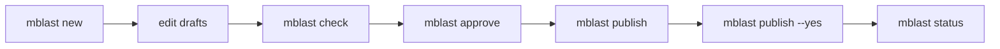

# Market Blaster guide

You ship a feature. Market Blaster turns that change into a post for each platform developers read and publishes it,
after you approve every post. This guide takes you from a fresh machine to a published campaign.



## 1. Install once per machine

Requires Node 22.18 or newer (`node --version`) and git. `gh` is optional; it provides PR evidence and the Gist
token.

```bash
gh repo clone edwinjosechittilappilly/market-blaster ~/Documents/GitHub/market-blaster
cd ~/Documents/GitHub/market-blaster
npm install
npm link              # puts `mblast` on your PATH, pointing at this clone
mblast install-skill  # links the drafting skill into ~/.agents/skills and ~/.claude/skills
```

Install with `npm link` from the clone. A plain `npm install -g` doesn't work, because Node only runs TypeScript
outside `node_modules`.

To update later, run `git pull && npm install`. The link keeps pointing at the clone.

## 2. Set up a project

Do this in the repo whose features you want to announce:

```bash
cd ~/code/my-project
mblast init
```

This writes `market-blaster.yml`. Fill in the following:

| Key | What to put there |
|---|---|
| `brand.name`, `brand.pitch`, `brand.audience` | Who the project is for, in one line each |
| `brand.voice` | Rules the AI must follow, such as "first person, show code, no hype words" |
| `brand.links` | Repo, docs, site |
| `destinations` | The platforms to use, from `devto hashnode gist bluesky mastodon linkedin x hn reddit threads medium producthunt substack` |
| `canonicalHome` | Where the original article lives (`devto`, `hashnode`, or your own blog URL). Other article platforms point their canonical URL at it, so search engines credit one page |
| `campaignsDir` | Where drafts and publish state go. The default is `campaigns/` inside the repo. In a public repo, drafts become visible before launch once you commit them; point this outside the repo (for example `../launches`) if that matters |
| `agent.command` | The headless agent that writes drafts. The default is `[omp, -p]`; `[claude, -p]` also works |

Commit `market-blaster.yml`. Commit `campaigns/` too if the repo is private: `state.json` is the record of what you
posted where.

## 3. Credentials

On macOS, store credentials once per machine in Keychain (service `market-blaster`):

```bash
mblast auth set DEV_API_KEY
mblast auth set BLUESKY_IDENTIFIER
mblast auth set BLUESKY_APP_PASSWORD
mblast auth set MASTODON_TOKEN
mblast auth list  # sources only, never values
```

Each command reads a hidden value. To pipe a value, use `mblast auth set KEY --stdin`. Alternatively, copy
`.env.example` to `.env` in the project root (`init` adds it to `.gitignore`), or export variables in your shell.
Precedence is shell, project `.env`, then Keychain. On non-macOS use `.env` or shell variables.

| Platform | Mode | Setup |
|---|---|---|
| DEV | API | `DEV_API_KEY`: dev.to → Settings → Extensions → DEV Community API Keys |
| Hashnode | Optional API, needs Pro | `HASHNODE_TOKEN` and `hashnode.publicationId`; hashnode.com → Settings → Developer |
| GitHub Gist | API | `GITHUB_TOKEN` or `gh auth refresh -s gist` |
| Bluesky | API | `BLUESKY_IDENTIFIER` and `BLUESKY_APP_PASSWORD`; create an app password in Settings, not your login password |
| Mastodon | API | Create an account on hachyderm.io and an application with `read:accounts` and `write:statuses`; store `MASTODON_TOKEN`. Set `mastodon.host: hachyderm.io` and `mastodon.maxChars: 2263` in the config |
| LinkedIn | Handoff or opt-in API | Follow the LinkedIn steps below; set `linkedin.api: true` for API publishing |
| X | Free intent link | No keys needed; the paid API is optional with `x.api: true` |
| HN, Reddit, Threads, Medium, Product Hunt, Substack | Handoff | No credentials needed |

For LinkedIn API access, create an app in the [LinkedIn Developer Portal](https://www.linkedin.com/developers/apps),
add the **Share on LinkedIn** and **Sign In with LinkedIn using OpenID Connect** products, and register
`http://localhost:8723/callback` as an authorized redirect URL under Auth. LinkedIn's own
[example app](https://github.com/linkedin-developers/linkedin-api-js-client/blob/master/examples/oauth-member-auth-redirect.ts)
uses an `http://localhost` redirect the same way.
Then store the app credentials and authorize in your browser:

```bash
mblast auth set LINKEDIN_CLIENT_ID
mblast auth set LINKEDIN_CLIENT_SECRET
mblast auth linkedin
```

The token and issue date are stored in Keychain. Tokens last about 60 days; `doctor` warns after 50 days to rerun
`mblast auth linkedin`.

```bash
mblast doctor           # api / handoff / missing and credential sources
mblast doctor --online  # also makes one authenticated read per API destination
```

## 4. Announce a feature

### Collect evidence and draft in one step

```bash
mblast new search-filters --range v1.3.0..HEAD --pr 42 --version 1.4.0
```

This runs three commands in a row:

1. **`mblast brief`** writes `campaigns/search-filters/brief.md`. It contains the commits, the diff stat, the diffs of
   the README, docs, examples and tests (up to 400 lines), the PR body and the CHANGELOG section. Each section has an
   anchor such as `[E3]`.
2. **`mblast draft`** runs your agent with the `market-blaster` skill. The agent writes one file per destination in
   `campaigns/search-filters/drafts/`.
3. **`mblast check`** validates the drafts.

You can also run them one at a time. Add context the commits don't show to the `Notes from the author` section of
`brief.md` (who asked for the feature, why it matters), then re-run `mblast draft search-filters --force`.

### Drafting inside omp or Claude Code

To draft interactively instead, ask your agent:

> Use the market-blaster skill to draft posts for campaign search-filters.

It reads the same brief and config and writes the same files.

### Read and edit the drafts

Each draft is Markdown with frontmatter:

```markdown
---
destination: bluesky
evidence: [E2, E7]
---
Search now takes filters: `repo:`, `lang:` and `is:open` combine in one query.

Before: three searches. After: one. Docs and examples: {{url:devto}}
```

| Field | Meaning |
|---|---|
| `evidence` | The brief sections the claims come from |
| `{{url:devto}}` | Replaced at publish time with the URL of the DEV article |
| `title` | Required for DEV, Hashnode, Gist, HN, Reddit and Substack |
| `tags`, `canonical` | Optional |

Edit freely. The AI wrote a first draft; you own the final one.

### Check

```bash
mblast check search-filters           # errors exit 1; grounding warnings don't
mblast check search-filters --strict  # warnings fail too (useful in CI)
```

Check reports errors and warnings:

- **Errors:**
  - missing fields;
  - evidence anchors that aren't in the brief;
  - posts over a platform's limit, with every link counted as 100 characters (Bluesky 300 graphemes, X 280 weighted
    characters, Mastodon your instance's limit);
  - links to a platform that publishes later.
- **Warnings:** numbers, versions and code identifiers that don't appear in the brief. These are the usual places
  where an AI invents things.

### Approve

```bash
mblast approve search-filters
```

This needs an interactive terminal. It shows each draft and asks `approve <destination>? [y/N]`. The approval records
a hash of that exact text, and publishing refuses anything that isn't approved or changed after approval. Because of
the terminal requirement, an agent can't approve on its own.

### Dry run, then publish

```bash
mblast publish search-filters                 # dry run: payloads, modes and expected cost; sends nothing
mblast publish search-filters --stage --yes   # optional: create unpublished DEV/Hashnode drafts to preview rendering
mblast publish search-filters --yes           # publish for real
mblast publish search-filters --yes --open    # also open handoff compose pages and copy their text
```

Before the first write, `publish --yes` runs a preflight:

- it checks the drafts again;
- it resolves the links;
- it re-measures social posts with the real URLs;
- it signs in to every API destination.

If any of these fails, nothing is posted. Destinations then go out in this order:

1. the canonical home;
2. the other articles;
3. Gist;
4. Bluesky, Mastodon, LinkedIn, X;
5. handoffs.

Each line of output shows a status and a URL.

### Handoffs

Use `--assist` in a terminal to walk through unpublished handoffs in order:

```bash
mblast publish search-filters --assist
mblast publish search-filters --assist --only hn,reddit
```

For draft-allowed destinations, approve the draft first; assist shows and copies the resolved text. For outline
destinations it shows talking points but copies nothing: write the submission yourself. HN receives only a title and
link; write any text yourself, since HN forbids generated text and automated posting. Assist opens official compose
pages in your browser; you paste and submit manually. Paste each resulting HTTPS permalink to record it, press Enter
to skip, or `s` to stop. A custom Substack host requires confirmation. For newsletter targets, assist opens each
configured editorial page and records one permalink for the newsletter destination.

You can also record an outcome separately:

```bash
mblast mark search-filters hn --url https://news.ycombinator.com/item?id=123
```

### Launch directories

Project listings are one-time submissions, not posts for every campaign. Check eligibility and submit manually:

```bash
mblast launch
mblast launch --mark devhunt --url https://devhunt.org/tool/example
mblast launch
```

The checklist tracks DevHunt, AlternativeTo, Uneed, Indie Hackers and Product Hunt in
`campaigns/_launch.json` (under your configured `campaignsDir`). Listings and editorial approval are not guaranteed.

### Status

```bash
mblast status search-filters
```

## 5. When something goes wrong

| What you see | What it means | What to do |
|---|---|---|
| `failed` | The platform returned an error. The message is saved in `state.json` with credentials removed | Fix the cause and run `publish --yes` again. Only destinations that are not yet published are tried |
| `unknown` | The request timed out, so the post may or may not exist | Check the platform. If it's there, run `mblast mark <slug> <dest> --url <url>`. If not, run `mblast mark <slug> <dest> --not-posted`, then publish again |
| `blocked` | A post links to a destination that isn't published yet | Publish or fix that destination first |
| `refused: not approved` | The draft changed after approval | Run `mblast approve <slug>` again |
| An article (DEV, Hashnode, Gist) changed after publishing | Approve and publish again | It updates the article in place. No duplicate |
| A social post changed after publishing | Social posts can't be edited | `--force` posts it again as a new post |

## 6. Use it in CI

Publishing always needs a person at a terminal, because of `approve`. CI can still keep drafts honest:

```yaml
# .github/workflows/campaign-check.yml
on: [pull_request]
jobs:
  check:
    runs-on: ubuntu-latest
    steps:
      - uses: actions/checkout@v4
        with: { repository: edwinjosechittilappilly/market-blaster, path: .mblast, token: ${{ secrets.MBLAST_REPO_TOKEN }} }
      - uses: actions/checkout@v4
        with: { path: app }
      - uses: actions/setup-node@v4
        with: { node-version: 24 }
      - run: cd .mblast && npm ci && npm link
      - run: cd app && for d in campaigns/*/; do mblast check "$(basename "$d")" --strict; done
```

## 7. What each platform gets

| Destination | Shape the skill writes |
|---|---|
| DEV, Hashnode | Tutorial-style article: the problem, what changed, a code example, how to try it |
| Gist | A runnable snippet with a short README, only when the brief has a runnable example |
| LinkedIn | A short story: what you built, the lesson, one link |
| Bluesky, Mastodon, X | A hook within the limit and one link |
| HN | A `Show HN:` title, only when people can try it; no marketing words |
| Reddit | Discussion framing for the subreddit in `reddit.subreddit`; read the subreddit's self-promotion rules first |
| Threads, Medium, Product Hunt, Substack | Copy for a person to paste |

## 8. Costs

| Item | Cost |
|---|---|
| DEV, Gist, Bluesky, Mastodon | Free |
| Hashnode | Pro plan |
| X API | $0.20 per post with a link (the dry run prints this) |
| LinkedIn API | Unverified; free as a handoff |
| Drafting | One agent run per campaign |
