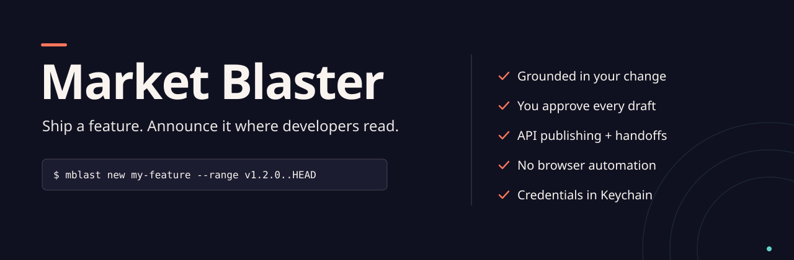
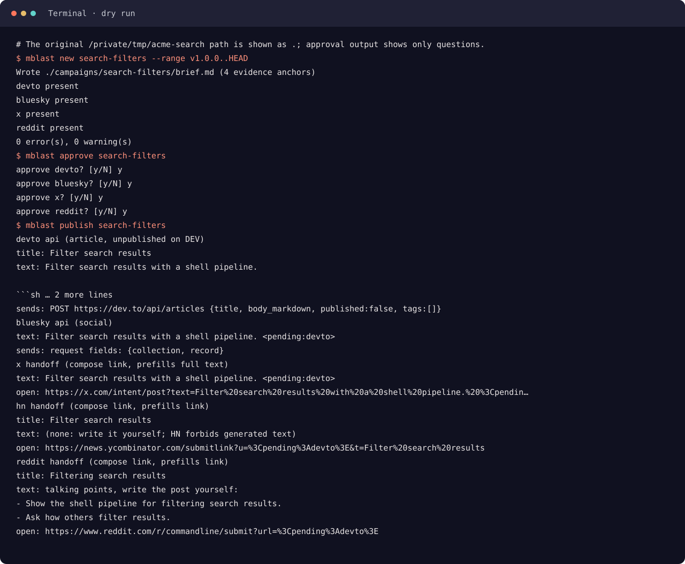

# Market Blaster { .visually-hidden }

Turn a shipped change into posts grounded in your commits, docs, PR and changelog. An agent drafts for each destination; you review and approve the exact text before publishing.

```bash
gh repo clone edwinjosechittilappilly/market-blaster && cd market-blaster
npm ci && npm link && mblast install-skill
```

Requires Node 22.18 or newer and access to the private repository. Run `mblast init` in the project you want to announce.

<div class="grid cards" markdown>

- **[Getting started](getting-started.md)**

    Install the CLI, set up a project, and choose destinations.

- **[Announce a feature](announce.md)**

    Collect evidence, draft, review, approve, and publish.

- **[Handoffs and assist](handoffs.md)**

    Submit manually where an API is unavailable or a platform requires original text.

- **[Credentials and security](credentials.md)**

    Set up access and understand what the Keychain and drafting environment protect.

</div>



For the full destination list, see [destinations](destinations.md). Market Blaster opens compose pages for manual handoffs; it does not automate websites.
